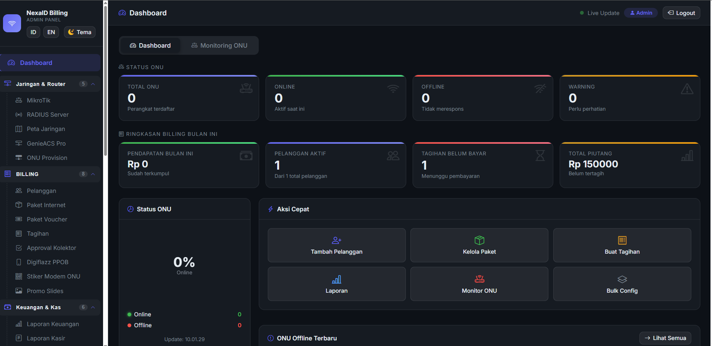

# NexaID Billing V2

**NexaID Billing V2** adalah sistem manajemen dan billing ISP/RTRWNET terpadu untuk mengelola pelanggan, jaringan, perangkat, tagihan, pembayaran, dan operasional tim dalam satu aplikasi.



## Fitur utama

- Dashboard operasional dan monitoring ONU secara langsung
- Manajemen pelanggan, paket internet, invoice, pembayaran, dan isolir otomatis
- Integrasi MikroTik untuk PPPoE, hotspot, voucher, FUP, dan pemantauan trafik
- Built-in ACS TR-069 serta dukungan integrasi GenieACS
- Manajemen OLT dan ONU melalui SNMP, Telnet, SSH, dan API
- Portal khusus admin, pelanggan, teknisi, agen, kolektor, dan kasir
- Notifikasi dan otomasi melalui WhatsApp serta Telegram
- Dukungan pembayaran QRIS dan beberapa payment gateway
- RADIUS server, inventaris, tiket dukungan, absensi, payroll, dan laporan keuangan
- Peta jaringan untuk pelanggan, ODP, dan jalur kabel
- REST API untuk aplikasi Android pelanggan
- Database MySQL untuk instalasi produksi yang konsisten dan terpusat

## Teknologi

- Node.js 22
- Express.js
- EJS dan Bootstrap
- MySQL melalui `mysql2`
- Baileys untuk WhatsApp
- RouterOS API, SNMP, SSH, dan TR-069/CWMP
- Leaflet untuk peta jaringan

## Persyaratan

- Node.js `>=22.0.0 <23`
- npm
- MySQL 8 atau MariaDB yang kompatibel
- Akses ke perangkat dan layanan eksternal sesuai fitur yang akan digunakan

## Instalasi

```bash
git clone https://github.com/kelvin2023-sys/billing-nexav2.git
cd billing-nexav2
npm install
```

Salin konfigurasi contoh:

```bash
cp settings.example.json settings.json
```

Buat file `.env` dan isi konfigurasi MySQL:

```env
DB_DRIVER=mysql
DB_HOST=127.0.0.1
DB_PORT=3306
DB_NAME=nexaid
DB_USER=root
DB_PASSWORD=
```

Jangan commit `.env`, `settings.json`, database, sesi WhatsApp, backup, log, atau upload pelanggan ke repository.

## Menjalankan aplikasi

Mode produksi:

```bash
npm start
```

Mode pengembangan:

```bash
npm run dev
```

Port dan alamat bind server mengikuti konfigurasi di `settings.json`.

## Pengujian

```bash
npm test
```

Gunakan Node.js 22 sesuai batas runtime yang ditentukan di `package.json`.

## Struktur proyek

```text
config/       Konfigurasi aplikasi dan adapter database
database/     Skema database
middleware/   Middleware Express
public/       Aset statis
routes/       Route portal dan REST API
scripts/      Migrasi dan alat pemeliharaan
services/     Logika bisnis dan integrasi eksternal
tests/        Pengujian otomatis
views/        Template antarmuka EJS
```

## Keamanan

- Ganti seluruh password dan secret bawaan sebelum digunakan di produksi.
- Gunakan HTTPS dan reverse proxy pada server publik.
- Aktifkan scheduler dan worker eksternal hanya setelah konfigurasi diverifikasi.
- Batasi akses jaringan menuju MikroTik, OLT, ACS, RADIUS, dan database.
- Lakukan backup database secara rutin dan simpan di lokasi terpisah.

## Repository

Pengembangan resmi NexaID Billing V2 tersedia di:

[github.com/kelvin2023-sys/billing-nexav2](https://github.com/kelvin2023-sys/billing-nexav2)

## Pemilik

**Kelvin Adi Saputra**  
GitHub: [kelvin2023-sys](https://github.com/kelvin2023-sys)

## Lisensi

Lihat berkas [LICENSE](LICENSE) untuk informasi lisensi proyek.
